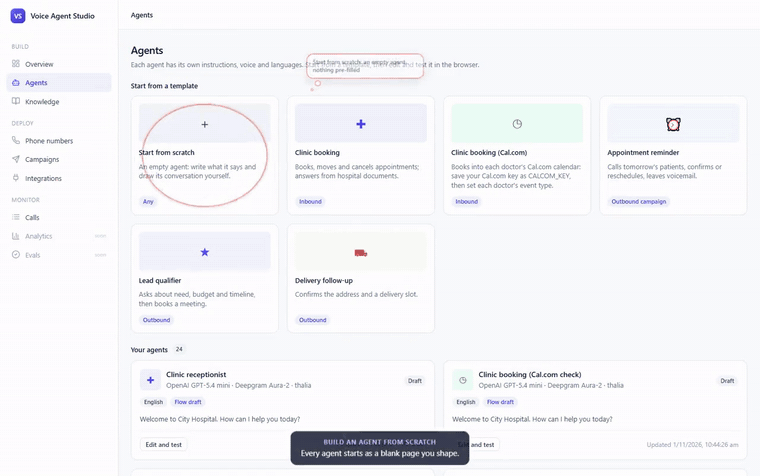
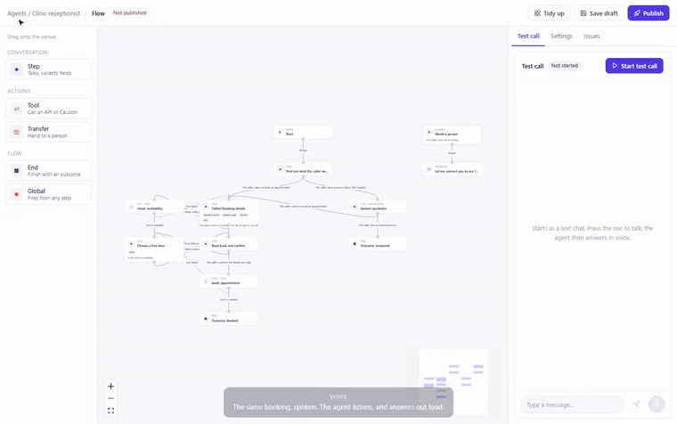
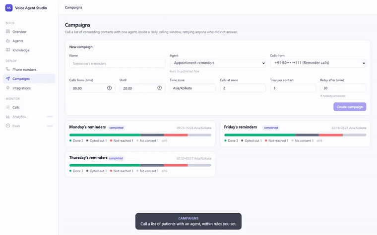
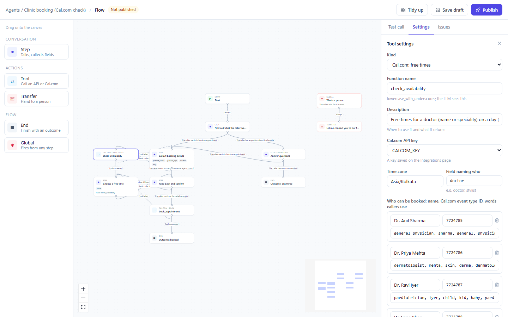
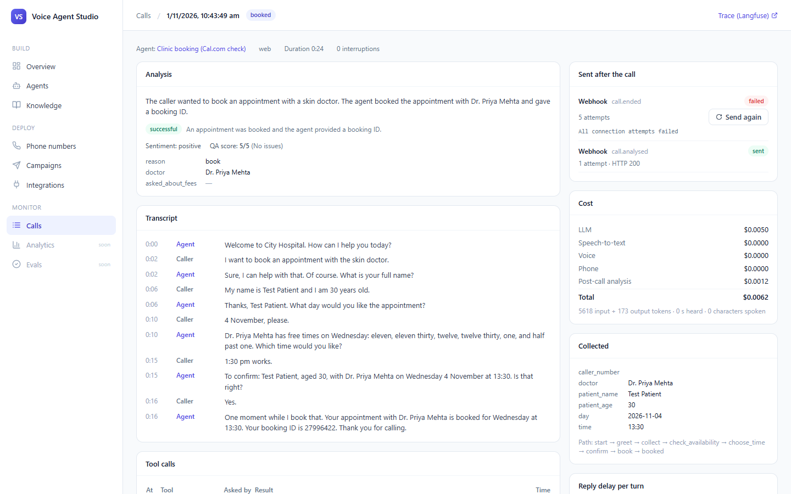
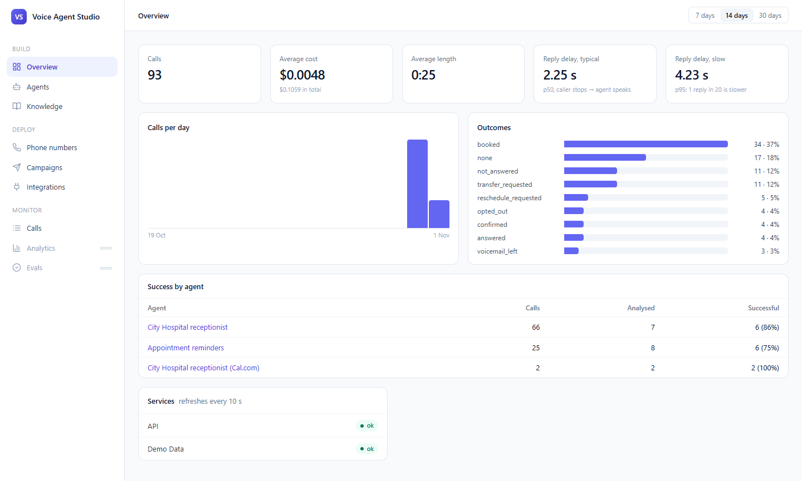
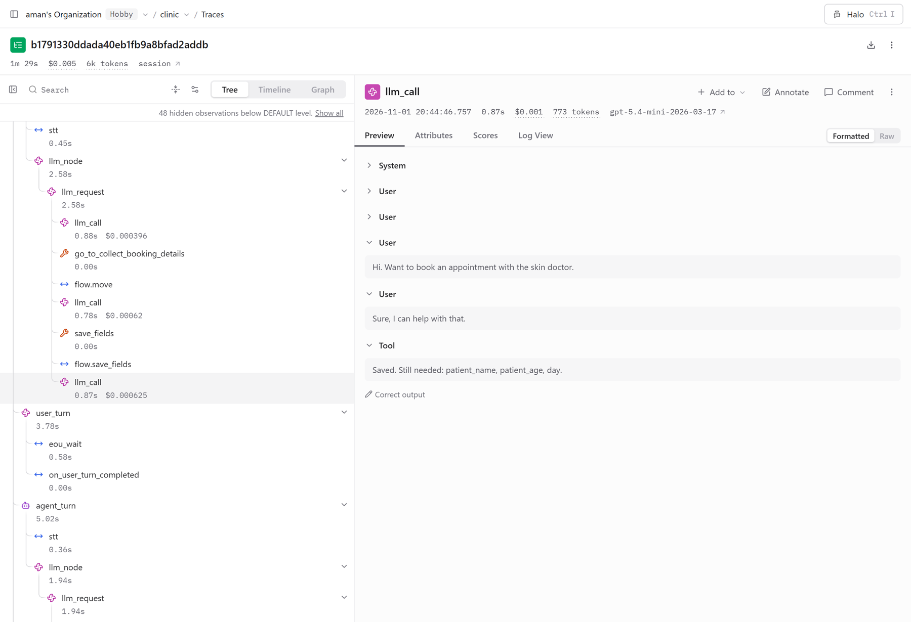
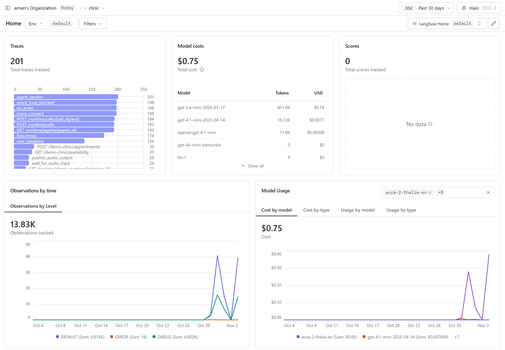

# Voice Agent Studio: AI Phone Agents Without Code (LiveKit + LangChain)

[](./LICENSE)

**[Website](https://voice-agent-studio-inky.vercel.app)** · **[Demo workspace](https://voice-agent-studio-inky.vercel.app/dashboard)** (read-only, sample data from real runs)

**Every business wants an AI on its phone line, but each agent still needs an engineer to build.**
Voice Agent Studio lets a business build its own voice agents in the browser: design the
conversation, test it, put it on a phone number, and see how every call went.

- **Front desk:** a caller asks for the skin doctor on Wednesday; the agent finds the doctor's free
  times in Cal.com, reads the details back and books the slot.
- **Reminder calls:** upload tomorrow's patients as a CSV and press start; each one ends confirmed,
  rescheduled, on voicemail or retried, and anyone who says stop is never called again.
- **A person when needed:** a caller who asks for a human is put through to the front desk.
- **After every call:** the transcript, summary, success, cost and reply speed land on the
  dashboard, and in HubSpot, Slack, Google Sheets or any webhook.

**The LLM can't skip a step:** code moves the call forward only once every detail is collected or
the booking has gone through.

---

## Architecture

<p align="center">
  
</p>

- **Agents are data, not code:** one voice agent worker serves every agent and loads the flow when a call starts.
- **Each call gets its own process:** LiveKit hands the call to a process that's already warm, so a crash in one call can't end another.
- **Calls don't wait in a queue:** browser tests, incoming phone calls and campaign calls all reach a process through a LiveKit room.
- **The backend is never in the audio path:** it is asked at the start, at the end, and for knowledge searches.
- **Slow work waits in Redis:** the backend adds jobs, and the background worker runs post-call analysis, deliveries to other apps and document ingestion. Its campaign dialler runs on a timer.
- **Keys never reach the LLM:** stored encrypted, filled in only when a tool sends a request.

## Concepts used

| Concept | In this project |
|---|---|
| **Real-time voice pipeline** | Streaming speech-to-text → LLM → voice over WebRTC and SIP, with turn detection and interruptions |
| **LLM wrapped in a state machine** | Code moves the call between steps; the LLM only talks inside one, with that step's prompt and tools |
| **Config-driven agent runtime** | Agents are configuration; one worker pool runs any agent, one process per call |
| **Tool calling with guardrails** | Each step can only use its own tools; bookings are idempotent and confirmed before they happen |
| **SIP telephony** | Inbound and outbound trunks, dispatch rules, answering-machine detection, transfer to a person |
| **Outbound campaign scheduler** | Calling windows per time zone, a concurrency limit, retries, consent and opt-outs, no double dials |
| **LLM-as-judge analytics** | Typed structured output per agent: summary, success, sentiment, custom fields, QA score |
| **Unit economics per call** | Token, speech and voice usage metered and priced for every call |
| **Hybrid RAG** | pgvector nearest neighbours re-ranked with keyword overlap |
| **Secure integrations** | Encrypted secrets, injection-safe templating, HMAC-signed webhooks retried with backoff |
| **Observability** | Langfuse traces per call, reply latency per turn, every tool call logged |
| **Provider-agnostic AI** | LLM, embeddings and speech chosen by a config string through LangChain |

## Demo videos

**[Build an agent from scratch](docs/demo/build-agent.mp4)** (2.5 min; the preview plays at 3.5×): a name, a greeting and
instructions, one step that collects name, phone and day, an ending, publish, and a test call.

<p align="center"><a href="docs/demo/build-agent.mp4"></a></p>

**[A booking by voice](docs/demo/voice-demo.mp4)** (1.5 min with sound; the preview plays silent at 2.5×): the caller speaks, the
agent checks the doctor's free times, reads the details back and books.

<p align="center"><a href="docs/demo/voice-demo.mp4"></a></p>

**[A reminder campaign](docs/demo/campaign.mp4)** (1 min; the preview plays at 1.5×): upload a CSV and start; six real phone
calls end confirmed, moved, opted out, on voicemail, not reached, or never called.

<p align="center"><a href="docs/demo/campaign.mp4"></a></p>

## Screenshots

**A Cal.com tool in the flow builder:** each doctor is a Cal.com event type.

<p align="center"></p>

**A call:** the analysis, transcript, tool calls, cost, and what was sent after the call.

<p align="center"></p>

**The dashboard:** outcomes, cost, reply speed and success by agent.

<p align="center"></p>

**Langfuse, one call's trace:** speech-to-text, each LLM call, the tools it asked for and every flow move, with timing and cost. This voice booking took 1 min 29 s and used 6k tokens, for $0.005 of LLM cost.

<p align="center"></p>

**Langfuse, cost over 30 days:** LLM spend per model across this project's test and demo calls. Langfuse prices LLM tokens only; the full cost per call, with speech and voice, is on the call's page above.

<p align="center"></p>

## Results from real runs

| Measure | Result |
|---|---|
| **Reply time** on voice calls (caller stops → agent starts speaking) | 2.25 s typical (p50), 4.23 s slow (p95) |
| Where that time goes | speech-to-text ~0.45 s, voice starts in 0.3-0.5 s, the rest is the LLM |
| **Cost per call** (LLM, speech, voice and post-call analysis) | $0.005 on average over 93 calls; $0.006 for a full typed booking |
| **Post-call analysis accuracy** on 11 real calls with known answers | 33 / 33 answers right, 1.2-2.8 s per call |
| **Calendar booking** with Cal.com during a call | free times in ~0.5 s, booking in ~2.4 s (the agent says "One moment" meanwhile) |
| **Campaigns** | every contact ends with an outcome; calls at once stay within the set limit |

## Run it locally

You need Docker, a [LiveKit Cloud](https://cloud.livekit.io) project (free plan), an OpenAI API key
and a Deepgram key.

```powershell
Copy-Item .env.example .env.local      # LIVEKIT_*, OPENAI_API_KEY, DEEPGRAM_API_KEY, RUNTIME_API_TOKEN, SECRETS_KEY
docker compose up -d --build
```

- Website: <http://localhost:3000>
- Dashboard: <http://localhost:3000/dashboard> (Overview shows every service's health)
- API docs: <http://localhost:8000/docs>

Then: **Agents → Clinic booking → Open flow builder → Start test call**, and book an appointment,
or pick **Start from scratch** to build your own. For a phone number, add one under **Phone
numbers**; for Cal.com, save your key under **Integrations** and create an agent from **Clinic
booking (Cal.com)**.

**Commands**

| What | Command |
|---|---|
| Backend tests | `cd backend\studio-backend; .\.venv\Scripts\python.exe -m pytest` |
| Voice agent tests | `cd backend\voice-agent; .\.venv\Scripts\python.exe -m pytest` |
| Lint and format check (Python) | `.\.venv\Scripts\ruff.exe check . ; .\.venv\Scripts\ruff.exe format --check .` |
| Frontend | `cd frontend; npm run dev` · `npm run lint` · `npm run build` |

Each Python app (`backend/studio-backend`, `backend/voice-agent`, `examples/demo-clinic`) has its own virtual environment:
`python -m venv .venv` then `.\.venv\Scripts\python.exe -m pip install -e ".[dev]"`.

## Project structure

```text
voice-agent-studio/
├── frontend/                  one Next.js app: the product page at /, the dashboard at /dashboard
├── backend/
│   ├── studio-backend/        FastAPI API and background worker
│   │   ├── src/studio_backend/
│   │   │   ├── agents/            agents, browser-call tokens, ready-made examples/ (one file each)
│   │   │   ├── flows/             flow schema, validation, draft/publish
│   │   │   ├── knowledge/         knowledge bases, ingestion, hybrid search
│   │   │   ├── phone_numbers/     phone numbers, SIP trunks, outbound calls
│   │   │   ├── campaigns/         campaigns, contacts, CSV import, the dialler
│   │   │   ├── calls/             call records, cost, post-call analysis, dashboard
│   │   │   ├── integrations/      saved keys (credentials/), results sent to Slack, HubSpot, Sheets, webhooks (deliveries/)
│   │   │   ├── core/              settings, database, job queue, tracing, internal auth
│   │   │   └── main.py · worker.py · health.py
│   │   ├── migrations/            Alembic (0001-0012)
│   │   └── tests/
│   └── voice-agent/           the LiveKit agent that talks on calls
│       ├── src/studio_voice/
│       │   ├── call/              one call: session, metadata, phone line, speech, LLM
│       │   ├── flows/             flow runner, per-step graph, prompts
│       │   ├── tools/             HTTP, Cal.com and knowledge search tools
│       │   ├── locales/           each language's rules, messages and answer parsers
│       │   ├── core/              settings, tracing, backend client
│       │   └── worker.py · languages.py
│       └── tests/
├── examples/
│   └── demo-clinic/           a stand-in hospital booking API for the clinic template
├── evals/                     scenario, campaign, Cal.com and post-call analysis checks
├── docs/                      architecture diagram, screenshots, Langfuse traces, demo videos
└── compose.yaml               Postgres (pgvector), Redis, RustFS and every app above
```
